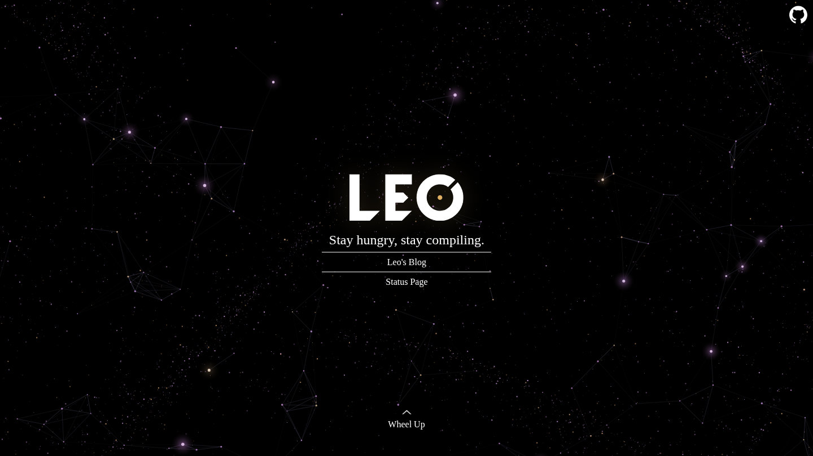

# Leo's Constellation Field

Leo 的个人发布页 / 网站导航，收录我自建和部署的各类站点。


[在线访问](https://li.trageek.com/) | [GitHub](https://github.com/continue33) | [更新日志](./CHANGELOG.md)



基于 Vue 3 + vite-ssg 的静态导航页，自适应布局兼容桌面与移动端：

- 星空连线背景（Canvas 2D 实时绘制，无外部依赖，随鼠标轻微视差），独立组件见 [continue33/Vibe-UI](https://github.com/continue33/Vibe-UI)
- 站点抽屉：按分类展示，带站点预览图与搜索框
- 欢迎标语随机轮换

# 1. 部署

## 1.1 Vercel 自动部署

Fork 本仓库后在 Vercel 导入即可，推送到 `master` 分支会自动重新部署。

[](https://vercel.com/new/clone?repository-url=https%3A%2F%2Fgithub.com%2Fcontinue33%2FBlog-Index&repository-name=Blog-Index)

## 1.2 修改配置

所有内容都在 `src/config.ts`：

- `WEBSITE_SORTS`：抽屉里的分类与站点
- `GITHUB_URL`、`BLOG_URL`：首页图标链接
- 欢迎标语等其他选项

站点配置示例：

```ts
const WEBSITE_SORTS: WebsiteSort[] = [
  {
    title: "示例分类",
    sites: [
      {
        /** 网站标题 */
        title: "主标题",
        /** 简介 */
        description: "一句话介绍",
        /** 网站 url */
        url: "https://www.your-web-page.com/",
        /** 网站 icon 图标，非必填，留空默认展示网站标题的第一个字符 */
        icon: "",
      },
    ],
  },
];
```

站点预览图放在 `public/previews/<url-slug>.webp`，也可以在配置中用 `preview` 字段单独指定。

## 1.3 手动部署

环境要求：

- node >= 18
- yarn 1.22.19

```sh
git clone https://github.com/continue33/Blog-Index.git
cd ./Blog-Index
yarn install
yarn build
```

将 `dist` 目录下的文件部署到任意静态服务器即可。

# 2. 开发

```sh
yarn install
yarn dev
```

# 3. 致谢

本项目 Fork 自 [EsunR/Blog-Index](https://github.com/EsunR/Blog-Index)，感谢原作者的开源。
